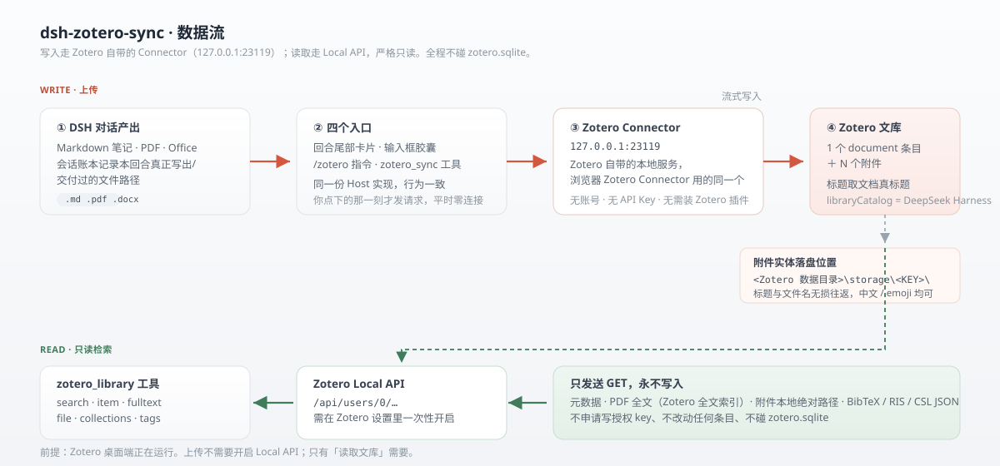
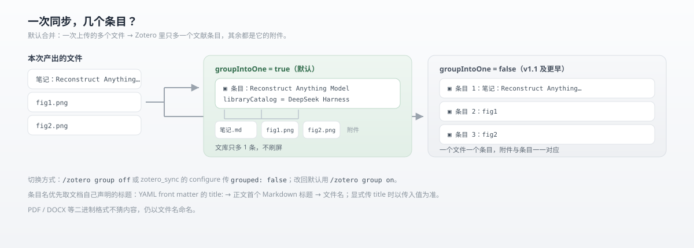

<p align="center">
  
</p>

<h1 align="center">dsh-zotero-sync</h1>

<p align="center">
  <sub>Sync the documents your DSH conversations produce into your local Zotero library — and let the agent read your library back.</sub>
</p>

<p align="center">
  <a href="README.md">简体中文</a> · <b>English</b>
</p>

<p align="center">
  <a href="https://github.com/520limited/dsh-zotero-sync/releases"></a>
  <a href="LICENSE"></a>
  
  
  
</p>

<p align="center">
  <a href="https://dsh-plugin.org/zh/plugins/520limited/dsh-zotero-sync"></a>
</p>

> **Note**: the interface GIF for the first screen (`docs/media/demo.gif`) is not recorded yet; the slot is reserved. Recording instructions live in [docs/media/README.md](docs/media/README.md). The diagrams below are ready.

---

## What it solves

Reading papers and writing notes with DSH scatters output across turns: a `.md` here, an analysis document there. Filing them into Zotero by hand means drag, create item, attach file — every time.

With this plugin, **every finished turn grows a Zotero row under its deliverables card**: one line per document that turn produced, upload one or all. After many turns, a "Zotero sync" chip under the composer pushes the whole conversation's qualifying files into the library in one go.

It connects to Zotero **only at the moment you click upload** — zero requests, zero polling otherwise.

## Install

**The only prerequisite**: the Zotero desktop app is running.

### Option 1 — one command (recommended)

```bash
dsh plugin --profile desktop add github:520limited/dsh-zotero-sync
```

Replace `--profile` with the profile you actually use (`ls ~/.dsh/profiles/`; browsers usually `web`, desktop usually `desktop`).

### Option 2 — plugin manager

Open **Plugins** in the DSH sidebar → **Add plugin**, and enter:

```
github:520limited/dsh-zotero-sync
```

### Option 3 — built-in market (Discover)

Settings → Plugins → indexes, add:

```
https://raw.githubusercontent.com/520limited/dsh-zotero-sync/main/market/index.json
```

Then search `zotero` on the Discover page.

### Option 4 — local directory (development)

```bash
git clone https://github.com/520limited/dsh-zotero-sync
# then install that directory from the DSH plugin manager
```

Restart DSH once after installing (desktop builds bundle the client half, which reloads with the page).

## First: the agent can read your library

This is the half you use daily — let the agent actually *see* what you have collected. Strictly read-only.

| Action | Description |
|---|---|
| Search items | By keyword/tag/item type/collection; returns title, authors, year, publication |
| Item detail | Full metadata + attachment/note lists; export **BibTeX / RIS / CSL JSON** |
| **PDF full text** | Extracts the attachment's text (Zotero's full-text index) so the agent can read the paper |
| Attachment path | Returns the PDF's absolute local path so the agent can read the file directly |
| Collections/tags | Lists them, to narrow a search |

Commands: `/zotero find [query]`, `/zotero read <KEY>` (`--bibtex`, `--file`), `/zotero collections`.
Tool: `zotero_library` (`search` · `item` · `fulltext` · `file` · `collections` · `tags`).

Typical use: *"Find my ultrasound standard-plane papers, read the methods section of the 2024 one, and cite it in APA."* — the agent runs search → fulltext → answers with the citation. Read-only throughout.

**One-time prerequisite**: reading goes through Zotero's Local API, off by default. In **Zotero → Settings → Advanced → Miscellaneous**, tick **"Allow other applications on this computer to communicate with Zotero"**, then restart Zotero.

> Uploading is **not** affected by that switch. Reading is read-only: no write requests, no write-authorisation key, no item is modified.

## Second: writing into the library



It talks directly to Zotero's built-in Connector service (`http://127.0.0.1:23119`, the same one the browser Zotero Connector uses).

- ✅ No Zotero account, no API key
- ✅ Nothing to install inside Zotero
- ✅ Never touches `zotero.sqlite`, no Zotero restart needed
- ⚠️ The only prerequisite: the Zotero desktop app is running (Connector protocol verified on Zotero 10.0.6 / 10.0.7)

Each file becomes a `document` item (**titled after the document's own title**: YAML front-matter `title:` first, then the first Markdown heading, then the filename without extension; `libraryCatalog` reads `DeepSeek Harness`). The original file streams into Zotero storage as an attachment, with Chinese and emoji filenames/titles round-tripping intact.

### Many files in one sync, one item



Since v1.2.0 several files uploaded together land in **one** Zotero item, each as an attachment. The title comes from the **first file in the batch** that actually gets uploaded (its body title, not its filename).

To go back to one item per file: `/zotero group off`, or pass `grouped: false` to `zotero_sync`'s `configure`.

> Why not the filename: a note named `202611231336.md` would enter the library as "202611231336", which reads like a path fragment. The item name is now the document's real title, e.g. "Reconstruct Anything Model: a lightweight general model for computational imaging". Pass `title` to force a name; it always wins over extraction. Only Markdown / plain text are read for titles; PDF and DOCX are not guessed at and still fall back to the filename (since v1.3.0).

## Four entry points, one implementation

| Entry | Where | Scope |
|---|---|---|
| Per-file button | Zotero card at the turn tail, right of each row | That one file |
| Batch button | Top-right of the same card | Every document this turn produced |
| "Zotero sync" chip | Under the composer | The whole session, filtered by your config |
| `/zotero` command + `zotero_sync` tool | Composer / agent-initiated | Everything |

All four run the same Host implementation. Natural language works too: *"upload that note to Zotero"*.

### Slash commands

```
/zotero status                 connectivity, current target and config
/zotero targets               list libraries and collections (L1 / C23)
/zotero use C23               remember a target collection for all uploads
/zotero scope md              file-type scope (md | docs | all)
/zotero source workspace      file source (session | workspace)
/zotero group on              many files into one item (default) | off = one per file
/zotero sync                  upload with the current config
/zotero sync "D:\notes\a.md"  explicit file (spaces and CJK paths supported)
/zotero sync --force          ignore the dedupe record and re-upload
/zotero find ultrasound       search the library (title/author/year)
/zotero read ABCD1234         read an item's PDF full text (--bibtex, --file)
/zotero collections           list collections
```

### Agent tool `zotero_sync`

`action`: `status` · `targets` · `candidates` (preview what would upload) · `sync` · `configure`.
The agent side obeys the same config and never uploads files you have not seen.

## Two orthogonal config dimensions

**source — where files come from**

| Value | Meaning |
|---|---|
| `session` (default) | Only files **this session wrote or delivered** (derived from `write`/`edit` results and `present` declarations). Never silently uploads files the conversation never touched |
| `workspace` | Scans the session working directory (depth 3, max 20, skipping `node_modules`, `dist`, `.git`…) |

**scope — which file types**

| Value | Meaning |
|---|---|
| `md` | Markdown only (`.md` / `.markdown`) |
| `docs` (default) | Markdown + txt + PDF + Office + web/ebook |
| `all` | Any type, **session source only** (keeps workspace scans from dragging in binaries) |

**groupIntoOne — how many items**

| Value | Meaning |
|---|---|
| `true` (default) | Files from one upload merge into **one** Zotero item, each as an attachment |
| `false` | One item per file (v1.1 and earlier behaviour) |

## Dedupe

Upload history is keyed by **content sha1**. Re-syncing an unchanged file reports "already in Zotero (C1, "Title")" instead of creating a duplicate; `--force` overrides. History lives in `plugin-data/dsh-zotero-sync/history.json` — delete it to forget everything.

## Configuration (optional)

Defaults live in the bundle's `cordis.patch.yml`; override them in your profile's patch layer. Runtime choices (UI/commands) take priority:

```yaml
- id: zotero-sync
  name: dsh-zotero-sync
  config:
    baseUrl: http://127.0.0.1:23119
    scope: docs          # md | docs | all
    source: session      # session | workspace
    groupIntoOne: true   # true = many files into one item; false = one item per file
    target: ''           # empty = follow Zotero's currently selected location
    tags: ['DSH对话笔记']
    workspaceLimit: 20
    workspaceDepth: 3
    maxFileBytes: 83886080
```

Precedence: call arguments > runtime store (`settings.json`) > patch config > built-in defaults.

## Permissions and risks

What happens after installing this, and what it does not do:

| Item | Detail |
|---|---|
| Network | Only `http://127.0.0.1:23119` (loopback), configurable via `baseUrl`. **Nothing is sent to any external server** |
| File reads | Upload: only the files you select when clicking upload; under `source: session` (default), only files this session wrote/delivered. Library reads: metadata and full text via the Zotero API only, never `zotero.sqlite` |
| File writes | No writes to Zotero's database. Upload history goes to `plugin-data/dsh-zotero-sync/history.json` (sha1 + metadata, no content) |
| Zotero side | Upload creates a `document` item + attachments. **The protocol has no delete endpoint, so the plugin cannot undo an upload** — delete it in Zotero yourself. Library reads are strictly read-only: no write requests, no write authorisation requested |
| Silent behaviour | None. Zero requests at mount, no background polling, no auto-upload, no auto-read |
| Account | No Zotero account or API key, and no credentials are read |

Known limits: Zotero must be running; Connector sessions expire after ~10 minutes; upload is "add" semantics with no library-wide dedupe (only local re-upload detection); library reads need the one-time Local API switch above, and PDF full text depends on Zotero's full-text index (unindexed attachments return nothing).

## Requirements

- DSH (DeepSeek Harness) desktop / web, `engines.dsh: >=0.2.0-0` (verified on 0.2.x)
- Zotero desktop running (upload verified on 10.0.6 / 10.0.7)
- Node ≥ 18 (bundled with DSH)

## Further reading

| Document | Contents |
|---|---|
| [CHANGELOG.md](CHANGELOG.md) | Version history and what each release did |
| [docs/development.md](docs/development.md) | Protocol pitfalls, code layout, how to run the tests |
| [docs/media/README.md](docs/media/README.md) | How the README figures and GIF are produced |

## Development

```bash
node test/protocol.test.mjs     # one suite; `npm test` runs all seven offline suites
npm test

# Creates real items in your Zotero library — skipped unless enabled:
npm run test:live
```

CI runs the same offline suites on Node 18 / 20 / 22 × Ubuntu / Windows (`.github/workflows/ci.yml`). The live suites need a running Zotero and never run in CI.

A tag is a release: `.github/workflows/release.yml` checks `package.json` against the tag, runs the offline suites, attaches the tagged source as a zip, and takes the release notes from that version's `CHANGELOG.md` section. It also publishes to npm when an `NPM_TOKEN` secret is configured.

## License

MIT
