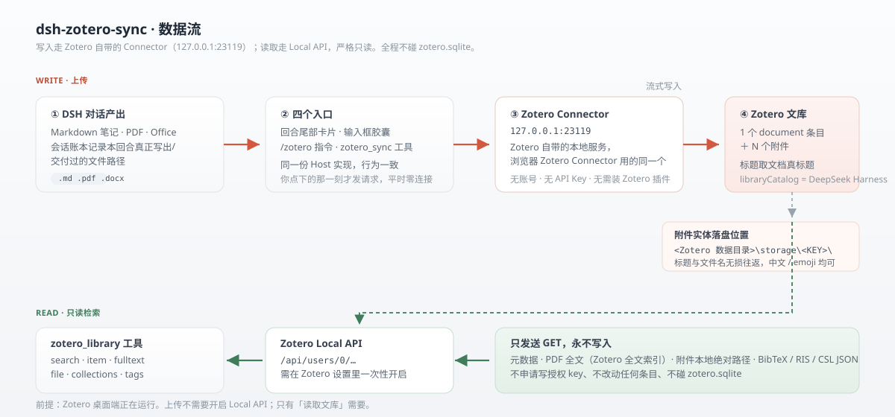
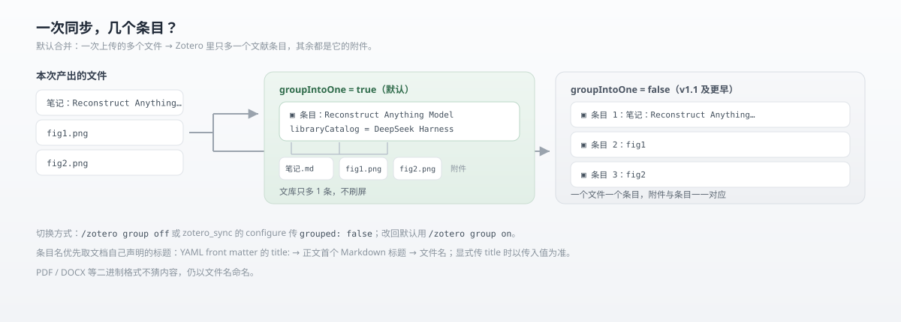

<p align="center">
  
</p>

<h1 align="center">dsh-zotero-sync</h1>

<p align="center">
  <sub>把 DSH 对话里产出的文档，一键收进本机 Zotero；也能让 Agent 只读翻你的文库。</sub>
</p>

<p align="center">
  <b>简体中文</b> · <a href="README.en.md">English</a>
</p>

<p align="center">
  <a href="https://github.com/520limited/dsh-zotero-sync/releases"></a>
  <a href="LICENSE"></a>
  
  
  
</p>

<p align="center">
  <a href="https://dsh-plugin.org/zh/plugins/520limited/dsh-zotero-sync"></a>
</p>

> **说明**：第一屏的界面动图（`docs/media/demo.gif`）待录制，位置已留好——见 [docs/media/README.md](docs/media/README.md) 的录制说明。下面的图示是已经就绪的数据流与合并逻辑。

---

## 它解决什么问题

用 DSH 做文献精读、写笔记时，产出散落在会话里：这轮一篇 `.md`，那轮一份分析文档。想整理进 Zotero 就得手动拖文件、建条目、配附件。

装上这个插件后，**每轮对话结束，回合尾部的交付物卡片下方会出现一个 Zotero 上传区**：本回合产出的每个文档一行，逐个传或一键全传。攒了很多轮之后，输入框下方还有一个「Zotero 同步」胶囊，按你配置的来源和范围把整个会话的文档一次收进文库。

全程只在**你点击上传的那一刻**才连接 Zotero —— 平时零请求、零轮询。

## 安装

**前提只有一条**：Zotero 桌面端正在运行。

### 方式一：一条命令（推荐）

```bash
dsh plugin --profile desktop add github:520limited/dsh-zotero-sync
```

`--profile` 换成你实际在用的那个（`ls ~/.dsh/profiles/` 查看目录名；浏览器版通常是 `web`，桌面版通常是 `desktop`）。

### 方式二：插件管理器里装

在 DSH 侧边栏打开**插件** → **添加插件**，输入：

```
github:520limited/dsh-zotero-sync
```

### 方式三：内置插件市场（Discover）

设置 → 插件 → 索引源（indexes）添加：

```
https://raw.githubusercontent.com/520limited/dsh-zotero-sync/main/market/index.json
```

之后在 Discover 页搜索 `zotero`。

### 方式四：本地目录（开发调试）

```bash
git clone https://github.com/520limited/dsh-zotero-sync
# 然后在 DSH 插件管理器里安装该目录
```

安装后**重启一次 DSH**（桌面端为打包运行，插件的 Client 半边需要随页面重新加载）。

## 先看：Agent 能读你的文库

这是日常用得最多的一半——让 Agent 直接「看」你收藏了什么文献，全程只读。

| 动作 | 说明 |
|---|---|
| 搜索条目 | 按关键词/标签/条目类型/分类检索，返回标题、作者、年份、期刊 |
| 条目详情 | 完整元数据 + 附件/笔记列表；可导出 **BibTeX / RIS / CSL JSON** 等引文格式 |
| **PDF 全文** | 提取附件的全文文本（Zotero 全文索引），Agent 可直接精读论文内容 |
| 附件路径 | 返回 PDF 在本机的绝对路径，Agent 可用文件工具直接读原文件 |
| 分类/标签 | 列出所有分类与标签，方便圈定检索范围 |

指令侧：`/zotero find [关键词]`、`/zotero read <KEY>`（`--bibtex` 导引文、`--file` 拿路径）、`/zotero collections`。
工具侧：`zotero_library`（actions: `search` · `item` · `fulltext` · `file` · `collections` · `tags`）。

典型用法：*"在我 Zotero 里找超声标准切面相关的论文，读一下 2024 年那篇的方法部分，用 APA 引用它。"* —— Agent 会 search → fulltext → 用引用格式回答，全程只读。

**一次性前提**：读取走 Zotero 的 Local API，Zotero 默认关闭它。请在 **Zotero → 设置 → 高级 → 杂项**，勾选 **「允许此计算机上的其他应用程序与 Zotero 通讯」**，然后重启 Zotero。

> 上传功能**不受**这个开关影响；读取永远只读：不发写请求、不申请写授权 key、不改动任何条目。

## 再看：往文库写



直连 Zotero 自带的本地 Connector 服务（`http://127.0.0.1:23119`，就是浏览器 Zotero Connector 用的那个）。

- ✅ 不需要 Zotero 账号、不需要 API Key
- ✅ 不需要在 Zotero 里安装任何扩展
- ✅ 不碰 `zotero.sqlite`，不依赖 Zotero 重启
- ⚠️ 唯一前提：Zotero 桌面端处于运行状态（Connector 协议在 Zotero 10.0.6 / 10.0.7 实测）

每个文件创建为一个 `document` 条目（**标题取文档自己声明的标题**：优先 YAML front matter 的 `title:`，其次正文第一个 Markdown 标题，再退回文件名去掉扩展名；`libraryCatalog` 显示 `DeepSeek Harness`），原文件作为附件流式写入 Zotero storage，中文/emoji 文件名与标题无损往返。

### 一次同步多个文件，只多一个条目



v1.2.0 起默认合并：一次同步的多个文件进**同一个** Zotero 条目，各自作为附件。标题取这一批里**第一个真正要上传的文件**的文档标题（即批次首篇的正文标题，而不是文件名）。

想恢复"一个文件一个条目"：`/zotero group off`，或 `zotero_sync` 的 `configure` 传 `grouped: false`。

> 为什么不再用文件名：像 `202611231336.md` 这种按时间戳命名的笔记，进 Zotero 后条目会叫 "202611231336"，读起来像路径碎片。现在条目名是文档里的真标题，例如「Reconstruct Anything Model: a lightweight general model for computational imaging」。想强制指定名字时传 `title` 即可，它始终优先于自动提取。只有 Markdown / 纯文本会读取正文标题；PDF、DOCX 等二进制格式不猜内容，仍退回文件名（v1.3.0 起）。

## 四个入口，一个操作

| 入口 | 位置 | 范围 |
|---|---|---|
| 单文件按钮 | 回合尾部 Zotero 卡片，每行右侧 | 那一个文件 |
| 批量按钮 | 同一卡片右上角 | 本回合产出的全部文档 |
| 「Zotero 同步」胶囊 | 输入框下方 | 整个会话按配置筛出的文件 |
| `/zotero` 指令 + `zotero_sync` 工具 | 输入框 / Agent 自动调用 | 全部能力 |

四个入口执行的是同一份 Host 实现，行为完全一致。你也可以直接用自然语言：*"把刚才那份笔记传到 Zotero"*。

### 斜杠指令

```
/zotero status                 连通性、当前目标与配置
/zotero targets                列出所有文库和集合（形如 L1 / C23）
/zotero use C23                记住目标集合，之后所有上传都送到这里
/zotero scope md               设置文件类型范围（md | docs | all）
/zotero source workspace       设置文件来源（session | workspace）
/zotero group on               多文件合并进一个条目（默认）｜ off = 一文件一条目
/zotero sync                   按当前配置上传
/zotero sync "D:\笔记\a.md"    显式指定文件（支持空格与中文路径）
/zotero sync --force           忽略去重记录，强制重传
/zotero find 超声              搜索文库（标题/作者/年份）
/zotero read ABCD1234          读条目 PDF 全文（--bibtex 导引文，--file 拿路径）
/zotero collections            列出文库分类
```

### Agent 工具 `zotero_sync`

`action` 取值：`status` · `targets` · `candidates`（预览将上传的文件）· `sync` · `configure`。
Agent 侧同样受配置约束，不会越权上传你没见过的文件。

## 两个正交的配置维度

**来源 source —— 文件从哪来**

| 值 | 含义 |
|---|---|
| `session`（默认） | 只传**本会话写出或交付**的文件（由 `write`/`edit` 工具结果与 `present` 声明推得）。绝不静默上传对话没碰过的文件 |
| `workspace` | 扫描会话工作目录（限深 3、最多 20 个，自动跳过 `node_modules`、`dist`、`.git` 等） |

**范围 scope —— 哪些文件类型**

| 值 | 含义 |
|---|---|
| `md` | 只要 Markdown（`.md` / `.markdown`） |
| `docs`（默认） | Markdown + txt + PDF + Office + 网页/电子书 |
| `all` | 不限类型，**仅对 session 来源生效**（避免工作区扫描拖进无关二进制） |

**组织方式 groupIntoOne —— 多文件落到几个条目**

| 值 | 含义 |
|---|---|
| `true`（默认） | 一次上传的多个文件合并进**一个** Zotero 条目，各文件是该条目的附件 |
| `false` | 每个文件一个独立条目（v1.1 及更早的行为） |

## 去重

按**文件内容 sha1** 记一笔上传历史。内容没变的文件再次 sync 会报告"已在 Zotero（位置 C1，《标题》）"而不会建重复条目；`--force` 可强推。历史记录在 `plugin-data/dsh-zotero-sync/history.json`，删掉即"失忆"。

## 配置（可选）

默认值写在 bundle 的 `cordis.patch.yml`，你可以在 profile 的补丁层覆盖；运行时用界面/指令做的选择优先级更高：

```yaml
- id: zotero-sync
  name: dsh-zotero-sync
  config:
    baseUrl: http://127.0.0.1:23119
    scope: docs          # md | docs | all
    source: session      # session | workspace
    groupIntoOne: true   # true = 多文件合并成一个条目；false = 一文件一条目
    target: ''           # 留空 = 跟随 Zotero 当前选中的位置
    tags: ['DSH对话笔记']
    workspaceLimit: 20
    workspaceDepth: 3
    maxFileBytes: 83886080
```

层叠优先级：调用参数 > 运行时存储（`settings.json`）> patch config > 内置默认。

## 权限与风险说明

透明起见，装上这个插件后会发生什么、以及它不做什么：

| 项 | 说明 |
|---|---|
| 网络访问 | 仅访问 `http://127.0.0.1:23119`（本机回环），可在配置中改 `baseUrl`。**不向任何外部服务器发送数据** |
| 文件读取 | 上传：只读你点「上传」时被选中的文件，`source: session`（默认）下仅限本会话写出/交付过的文件。读文库：只经 Zotero API 取元数据与全文，不碰 `zotero.sqlite` |
| 文件写入 | 不写 Zotero 数据库。上传历史写在 `plugin-data/dsh-zotero-sync/history.json`（sha1 + 元数据，不含正文） |
| Zotero 侧 | 上传：每个文件新建一个 `document` 条目 + 附件。**协议无删除端点，插件不能撤销已上传条目**，需要你在 Zotero 里手动删。读文库：**严格只读**，不发送任何写请求，也不申请写授权 |
| 静默行为 | 无。挂载时零请求，不做后台轮询、不自动上传、不自动读取 |
| 账号 | 不需要 Zotero 账号或 API Key，也不读取你的任何凭据 |

已知限制：Zotero 必须正在运行；Connector 会话约 10 分钟过期；上传是「新增」语义，不做文库内去重（只对本地已传过的内容去重）；读文库需一次性开启 Zotero 的本地 API 开关（见上文），PDF 全文依赖 Zotero 的全文索引（未索引的附件拿不到文本）。

## 要求

- DSH（DeepSeek Harness）桌面版 / Web 版，`engines.dsh: >=0.2.0-0`（0.2.x 实测）
- Zotero 桌面端运行中（上传实测 10.0.6 / 10.0.7）
- Node ≥ 18（DSH 自带）

## 相关文档

| 文档 | 内容 |
|---|---|
| [CHANGELOG.md](CHANGELOG.md) | 版本历史与每版做了什么 |
| [docs/development.md](docs/development.md) | 协议踩坑记录、代码结构、测试怎么跑 |
| [docs/media/README.md](docs/media/README.md) | README 图示与动图的录制说明 |

## 开发

```bash
node test/protocol.test.mjs     # 全套离线测试：npm test 会依次跑完这七个
npm test

# 会向你的真实 Zotero 文库创建条目，默认跳过：
npm run test:live
```

CI 在 Node 18 / 20 / 22 × Ubuntu / Windows 上跑同一组离线套件（见 `.github/workflows/ci.yml`）；live 套件需要一台正在运行 Zotero 的机器，永远不进 CI。

打 tag 即发布：`.github/workflows/release.yml` 会校验 `package.json` 与 tag 一致、跑离线套件、把该 tag 的源码打成 zip 附到 Release、并从 `CHANGELOG.md` 提取对应版本段的发布说明。配了 `NPM_TOKEN` secret 时额外发布到 npm。

## License

MIT
