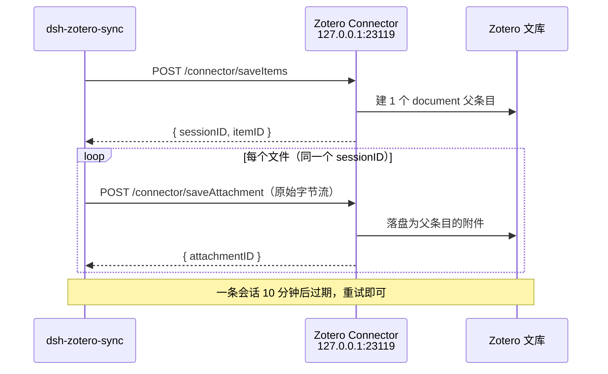

# 协议与实现笔记

改动 `zotero.mjs` / `library.mjs` 前请先读完这份。每一条都来自 Zotero 10.0.6 源码核对 + 真实 500 错误复盘，不是猜测。

## 上传：Zotero Connector 协议（`zotero.mjs`）



1. 必须带 `X-Zotero-Connector-API-Version: 3` 且 UA **非**浏览器形状，否则请求被静默拒绝。
2. `/connector/saveItems` 的 payload **不能带 `proxy: {}`** —— 空对象也会让 Zotero 构造 `new Zotero.Proxy({})` 而返回裸 500。
3. 附件走 `/connector/saveAttachment` 原始流：Content-Type 不能是纯文本类型（`text/plain` 会被 Zotero 缓冲成字符串、破坏流式写入），所以 `.txt` 改标 `application/octet-stream`；`.md` 保留 `text/markdown` 以便 Zotero 内预览。
4. `X-Metadata` 头按 latin-1 传输，非 ASCII 一律 `\uXXXX` 转义，中文标题才能无损往返。
5. `updateSession` 对 `target` 无空值保护，任何调用都必须带显式 target。
6. Connector 保存会话约 10 分钟过期（`SESSION_NOT_FOUND` → 提示重试即可）。
7. **多文件合并进一个条目**靠的不是多次 `saveFile`（那样每条都建自己的父条目），而是复用**同一个** session：`/connector/saveItems` 建一次父条目，随后对同一 `parentItemID`（即同一个 connector key）反复调 `/connector/saveAttachment`。`SaveAttachment` 内部是 `session.getItemByConnectorKey(metadata.parentItemID)`，key 一旦不同就会 500。实现见 `zotero.mjs` 的 `saveGroup()`。

## 读取：Zotero Local API（`library.mjs`）

8. 每个请求必须带 `Zotero-API-Version: 3`，其他版本一律 501（仅 `/api/` 根豁免）；userID 必须 `0`。
9. 整个 API 在 pref `extensions.zotero.httpServer.localAPI.enabled` 之后，**默认 false** —— 关着时 `/api/*` 一律 403 "Local API is not enabled"。
10. GET 免鉴权；写请求需要 `/api/local/authorize` 发的 key —— 本插件只发 GET，永远不碰。
11. `/items/:key/file` 是 302 重定向；`/items/:key/file/view/url` 才是 200 明文返回本地路径，插件用后者。
12. `/items/:key/fulltext` 只对有全文缓存的附件（PDF 等）有效，否则 404；正文来自 Zotero 的全文索引。
13. 列表响应的分页真相在 `Total-Results` 响应头，不在 body。

## 代码结构

```
index.js        Host 半边：zotero_sync + zotero_library 工具 + /zotero 指令 + 会话产出账本
client.js       Client 半边：回合卡片 + 输入框胶囊（只发 /zotero sync，挂载时零请求）
zotero.mjs      Zotero Connector 协议客户端（纯 Node，可独立复用）
library.mjs     Zotero Local API 只读客户端（搜索/详情/全文/附件路径/分类/标签）
operations.mjs  文件发现 + 上传编排（source × scope 矩阵、去重、多文件合并）
settings.mjs    配置层叠与持久化
history.mjs     内容哈希上传记录
title.mjs       从 Markdown/纯文本正文提取真标题
test/           6 个离线套件 + 3 个显式开关的 live 套件
```

## 测试

```bash
node test/protocol.test.mjs     # 协议形状（桩 fetch，绝不连真 Zotero）
node test/behaviour.test.mjs    # source×scope 矩阵、配置层叠、工具/指令行为
node test/group.test.mjs        # 多文件合并成一个条目、部分变更、去重
node test/title.test.mjs        # 文档真标题提取（front matter → 首个标题 → 文件名）
node test/package.test.mjs      # 包结构、locale 一致、"挂载零请求"防回归断言
node test/deliverables.test.mjs # 会话产出账本 → candidates 全链路（离线）
node test/library.test.mjs      # Local API 只读客户端（桩 /api/users/0）

# 会向你的真实 Zotero 文库创建条目，默认跳过：
ZTS_LIVE=1 node test/live-sync.test.mjs
node test/live-group.test.mjs   # 真实上传 3 个文件，验证 1 条目 3 附件
node test/verify-group.test.mjs # 按标题回查该条目，打印附件清单（用完记得删测试条目）
```

> live 套件会在你的真实文库留下条目，跑完请手动删除。Connector 协议没有删除端点。

## 一次第三方 Zotero 版本核对记录

- 协议核对基准：Zotero 10.0.6（源码在 `D:\Zotero\app\omni.ja`）
- 上传实测：Zotero 10.0.6 / 10.0.7
- 读取实测：Zotero 10.0.7（Local API 开关打开后）
- 6.x–10.x 的 Connector 协议一致，但更老的版本未逐一实测，故 README 只写"已实测 10.x"。
